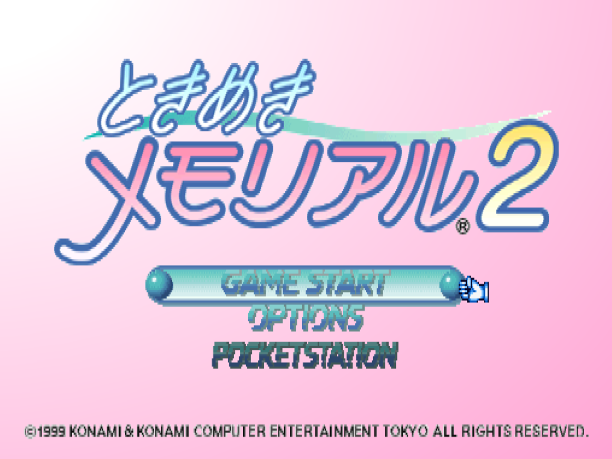
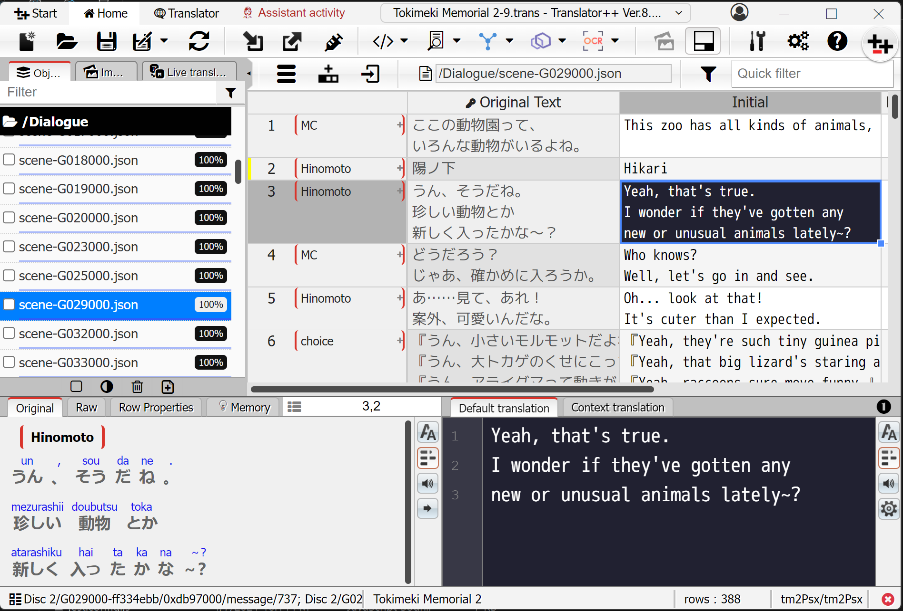

# Tokimeki Memorial 2 (PlayStation)

An independent [Translator++](https://dreamsavior.net/docs/translator/) add-on by
pismax for translating and modding the Japanese PlayStation release. Import your
discs, edit dialogue and artwork, and export a playable disc set.

[Download the English gameplay sample (MP4, 4:14)][video]

## Inside Translator++

The add-on labels dialogue rows when it can identify the speaker, so you can
see who’s talking while you edit. Menu textures open in Image Translator,
and scene artwork can be exported as PNGs for editing.

## Quick start

1. **Install.** On Translator++ **8.11.25 or later**, open **Options → Add-ons →
   Install → Community add-ons**, install **Tokimeki Memorial 2 Parser**, and
   restart. On **8.11.21–8.11.24**, follow the [manual install steps][manual].
   See the [Translator++ download page][download] for available builds.
2. **Import.** Open **New Project → Tokimeki Memorial 2 (PlayStation)** and
   select a disc folder or BIN/CUE files. Use Japanese Rev 1 discs
   (SLPM-86355–SLPM-86359) with one Mode 2/2352 data track per disc.
3. **Edit and export.** Set your target language, translate a few rows in
   **Dialogue**, and export to a folder. Open the generated M3U playlist or an
   individual CUE in your emulator to check the result.

See the [usage guide](USAGE.md) for screenshots and instructions on dialogue,
nameplates, menus, player names, and artwork.

[video]: https://raw.githubusercontent.com/pismax/tpp-tm2Psx/v0.1.47/showcase/english-sample.mp4
[manual]: https://github.com/pismax/tpp-addons#install
[download]: https://dreamsavior.net/download
